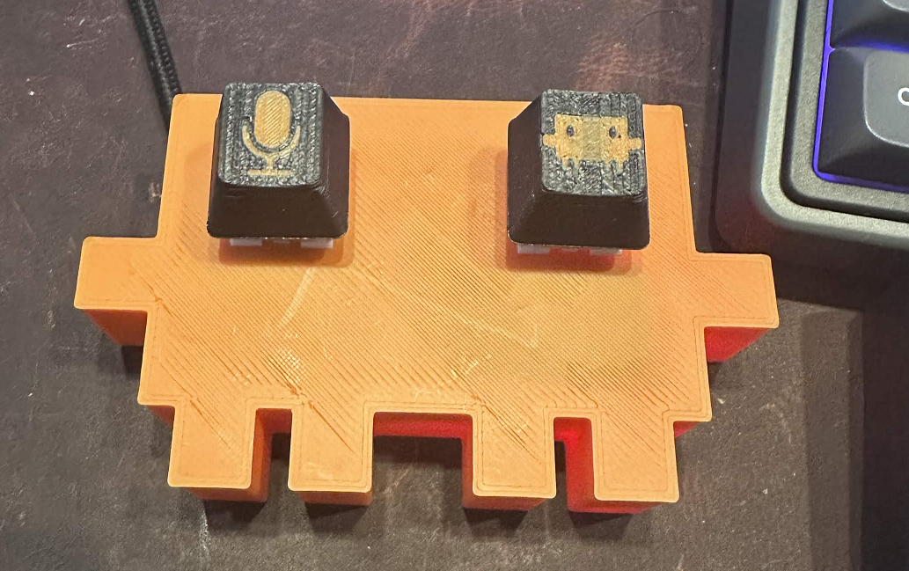

# claudeBoard

A two-button macro keyboard shaped like the Claude Code mascot. The eyes are the switches:

- **Left eye:** turns on voice dictation in the Claude Code VS Code extension.
- **Right eye:** sends the prompt.

## Hardware

- 3D-printed enclosure (`3d files/`):
  - `claudeBoard1.stl`: the top shell
  - `BottomPanel1.stl`: the bottom panel
  - `claudeBoard1.3mf` and `ClaudeBoard1.skp`: the print project and the SketchUp source
- Rubber feet for the bottom panel
- 2 × mechanical keyboard switches
- Arduino Pro Micro (ATmega32U4), clones work fine

## Wiring

| Switch | Pro Micro pin | Other leg |
|---|---|---|
| Left eye (mic) | 2 | GND |
| Right eye (send) | 3 | GND |

It doesn't matter which leg of the switch goes where. You don't need resistors, because the firmware uses the Arduino's built-in pull-ups.

## What the buttons do

| Switch | Key sent | Behavior |
|---|---|---|
| Left eye | Ctrl+D | Claude Code voice dictation. Tap to start or stop recording, or hold to talk and release to stop. |
| Right eye | Enter | Sends the prompt. |

The keyboard holds each key down for exactly as long as you hold the switch, so it behaves like pressing the key yourself. The buttons only work while the Claude Code chat panel has focus.

## Flashing the firmware

1. Open `arduino/claudeBoard/claudeBoard.ino` in the Arduino IDE.
2. Choose **Tools → Board → Arduino Leonardo**. This setting works for most 5V/16MHz Pro Micro clones.
3. Upload the sketch. `Keyboard.h` comes with the IDE, so there's nothing extra to install.

If an upload fails or the board stops showing up, connect RST to GND twice quickly. That puts it in bootloader mode for about 8 seconds. Click upload just before you do it.

## Troubleshooting

- **Mic doesn't start:** voice dictation needs you to be signed in to claude.ai, and VS Code needs permission to use the microphone.
- **Enter doesn't send:** if you've set the extension to send with Ctrl+Enter, change `KEY_RETURN` in the sketch to a Ctrl+Enter combo.
- **Changing the keys:** edit the key presses in `loop()` and upload again.

## License

MIT. See [LICENSE](LICENSE). This covers the firmware and the 3D files.
